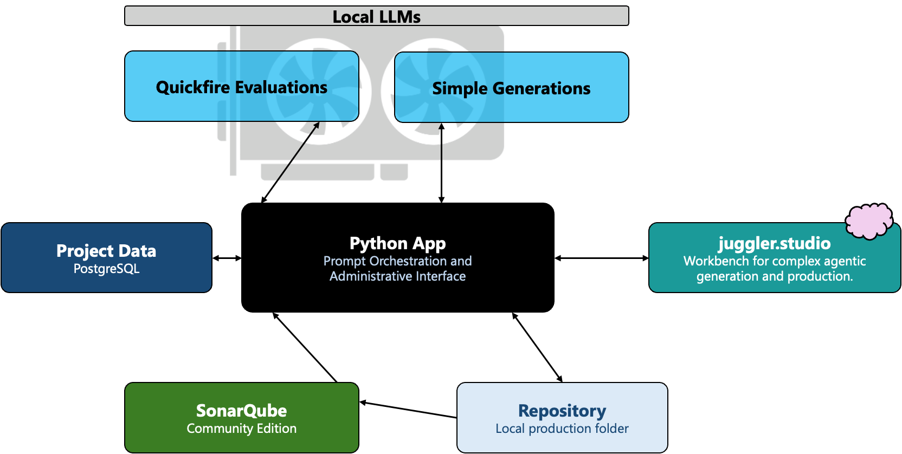
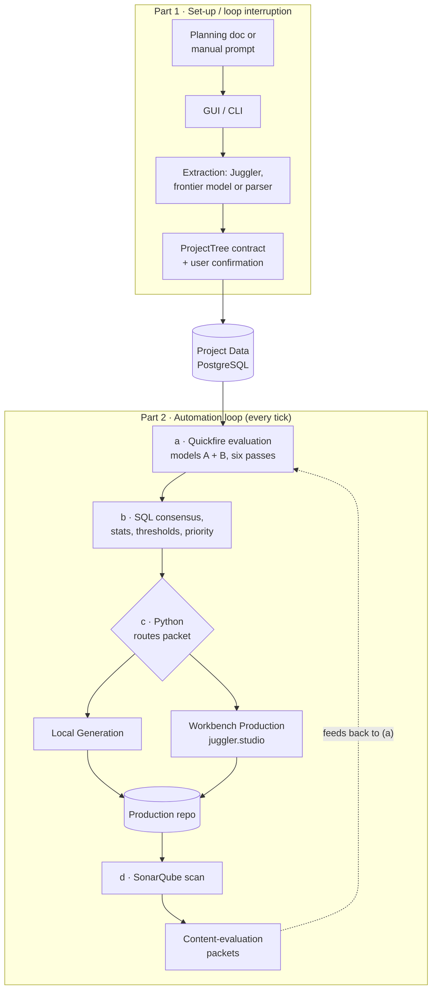

# PythonPlanner — Python Orchestrator · Project Plan

| | |
|---|---|
| **Document** | Project Plan — replaces the draft `Python Planner.docx` (archived at `docs/archive/`) |
| **Plan version** | 0.7 — R2 (M2 code) and R3 (M3 spec) consensus; M2.1 complete; M3 scope cuts |
| **Product target** | v1.0.0.0 prototype of the Python Orchestrator (package version `1.0.0.0.devN` until acceptance) |
| **Sponsor / CFO** | Sam (redtongues) |
| **Project manager** | Claude (PM agent) |
| **Main engineer** | Claude Code (cloud session, GitHub-connected) |
| **Review panel** | Microsoft Copilot · Gemini (Argon) · GitHub Copilot — consensus-scored (see §17) |
| **Repository** | `github.com/redtongues/PythonPlanner` (private) |
| **Last updated** | 2026-11-04 12:00 (checkpoint) |

---

## 0. Status at a glance — checkpoint 2026-11-04 12:00

| Item | State |
|---|---|
| Plan | v0.7 (this document) |
| M0 — plan and repo | Done |
| M1 + M1.1 — kernel foundation | **Merged** (PR #1, 3068e35) after reviews R0 and R1 |
| M2 — evaluation engine | **Merged** (PR #2, 1031665): M2 + the 12 M2.1 fixes from R2; 410 tests |
| R2 — panel review of M2 code | Done: 25 findings → 21 accepted, 1 deferred (GE7 → M3), 2 declined. Engineer's 7 open notes ruled (all accepted) |
| M3 — orchestration and interface | Spec reviewed *before* coding (R3: 46 findings, 43 adopted, 3 partial) and independently verified (V1–V11). Six scope cuts. State-machine reference D8. **Stage A done** (draft PR #3, 560 tests); review R4 running; Stage B (loop, channels, digest, C27–C39) next |
| M4 — Juggler bridge | Spec ready; now also owns the real `juggler run` CLI and worktrees (moved from M3) |
---|---|
| Plan | v0.5 (this document) — CFO decisions D13–D16 recorded; D3 and §20 questions still open |
| M0 — plan and repo | Done |
| R0 — panel review of plan | Done: 24 findings → 20 adopted (A1–A7, B1–B8, C1–C7) |
| M1 — kernel foundation | **PR #1** built by Claude Code (9 commits, ~5,800 lines); CI green on SQLite (Py 3.11/3.12) and PostgreSQL 16 |
| R1 — panel review of M1 code | Done: 24 findings → 18 accepted, 2 partial, 2 deferred to M2, 2 declined (verified false positives) |
| M1.1 — 12 review fixes | **In progress at pause.** The engineer checkpoints in `docs/PROGRESS.md` (done/remaining); PR #1 merges when CI is green |
| M2, M3 | Specs ready, with R0 amendments (and C8 pace governor) |
| M4 — Juggler bridge | Spec rewritten around the headless `juggler run` CLI (verified in Juggler's source) |
| Work paused | Claude Pro usage at 88%; resume after the reset. Steps for the next agent are in §22 |

---

## 1. Executive summary

The Python Orchestrator is the **custom Python kernel** at the centre of an autonomous software-development stack. It takes messy project-planning material, turns it into a standardised, governed database of **Project → Objective → Task (Prompt Packet)** records, and then keeps that work moving while the owner is at their day job:

- small **local LLMs** continuously score and tag every packet (six-pass "quickfire" evaluation);
- **SQL** turns those raw evaluations into deterministic decisions — consensus values, priority, routing, branching;
- the **Python kernel** dispatches ready packets to the right channel — local generation for simple work, the **juggler.studio** workbench for complex agentic production — and writes accepted results into a separate **production repository** that **SonarQube** checks;
- **completed work is locked**: the AI can never alter it; corrections become new versions.

**v1.0.0.0** is a working prototype of that kernel. It runs end-to-end on an ordinary laptop with a deterministic fake model (no GPU, no network), and on the target stack (PostgreSQL + Ollama-served local models + SonarQube) when those are available. It deliberately stops short of production hardening, a native Juggler extension and GPU scheduling, which are planned for v1.1+.

**Delivery approach.** Claude Code builds in three milestone rounds (M1 Foundation → M2 Evaluation engine → M3 Orchestration & interface). Every round is reviewed by a **three-model panel** — Microsoft Copilot, Gemini and GitHub Copilot — that mirrors the product's own six-pass design: independent findings, then cross- and self-scoring, then deterministic aggregation (`0.6 × cross + 0.4 × self`). The PM adopts only consensus changes that advance the Key Idea, merges to `main`, verifies independently, and keeps this plan current so any agent can pick up the work.

---

## 2. The Key Idea — the north star

> *Build an autonomous project software dev stack with a custom Python kernel. It should be utilised for organising and advancing project work autonomously for the user while they are working their day job.*

**Decision filter.** Every design choice, and every review suggestion, must serve at least one of these five properties — otherwise it is deferred to the backlog, however good it is in general:

| # | Property | What it means in practice |
|---|---|---|
| K1 | **Advances work unattended** | The loop runs for hours without a human, survives crashes/restarts (all state in the DB), and never blocks on a single failure. |
| K2 | **Governed, not freewheeling** | Every AI decision is recorded, scored, backed by evidence and gated by the user's autonomy settings. |
| K3 | **Deterministic where possible** | LLMs produce *candidate* data; SQL and Python make the *decisions*. |
| K4 | **Readable** | The user can open the GUI (or the database) at any moment and see what is happening and why. |
| K5 | **Safe history** | Completed work is immutable; corrections create new versions, never edits. |

---

## 3. Requirements and traceability

| ID | Requirement (from the draft) | How v1.0.0.0 meets it | Milestone | Acceptance evidence |
|---|---|---|---|---|
| **A** | Consolidate messy project planning documents into a standardised database | Ingestion pipeline (`.md`, `.txt`, `.docx`) → validated `ProjectTree` contract → Project / Objective / Packet tables. Deterministic parser first; LLM / Juggler extraction behind the same contract. | M1 parser · M2 LLM extraction | `orchestrator ingest` on sample docs creates the expected tree; tests |
| **B** | Use LLMs in conjunction with SQL scripting to fill out the metadata | Six-pass dual-model quickfire evaluation fills candidate fields; SQL views aggregate them to consensus and promote to master governance fields. | M2 | `v_field_consensus` tests; end-to-end evaluation with the fake provider |
| **C** | Autonomously evaluate and transform the database based on Scores and Tags | Threshold rules table → split / branch / route actions; priority computed in SQL; packets re-evaluated after change. | M2–M3 | Branching, routing and priority tests |
| **D** | Operate continuously, creating and executing Complex Tasks autonomously on a readable workbench | Kernel loop with three channels (Quickfire Evaluation, Local Generation, Workbench Production), run-ID contracts with retries, crash-safe state; workbench outbox/inbox readable by humans and by Juggler. | M3 | `orchestrator run`, `orchestrator demo` |
| **E** | Allow the user to configure manual input and agent independence scopes at each key stage | Autonomy scopes per stage (`manual` / `confirm` / `auto`) + approval queue; loop interruption with a custom prompt. | M1 schema · M3 enforcement + GUI | Scope enforcement tests; GUI approval queue |
| **F** | Preserve completed work as immutable to the AI | Database triggers block UPDATE/DELETE on locked packets, accepted artifacts, evaluation and event logs (SQLite **and** PostgreSQL); application guard; supersede-by-new-version; git history in the production repo. | M1 | Trigger tests on both databases |

---

## 4. Glossary

| Term | Definition |
|---|---|
| **Project / Objective / Task** | The three-level core tree. A Task *is* a Prompt Packet: `Project > Objective > Task (Prompt Packet)`. |
| **Prompt Packet** | Federated task metadata recursively evaluated to fill and substantiate fields. New packets are created for new independent or parsed tasks. Parsed packets do not remove the original but create branches with a linked history. A packet carries three layers: **core fields** (authoritative definition), **master governance fields** (operational state) and **candidate fields** (evaluative layer). |
| **genPacket** | A *generative* prompt packet — a real work item (Task). It is stored in Postgres, carries core fields plus evaluation fields (tags and scores), and enters the generation queue only when the deterministic readiness check passes. (Rows of `packets`.) |
| **evaPacket** | An *evaluative* sub-packet: a preset, stateless prompt to a local model that fills one evaluation field of one genPacket version, for one pass. High-volume and content-addressed; results go to the append-only `evaluation_passes` and are aggregated deterministically. Also used after generation to evaluate the output. |
| **Readiness** | The deterministic rule deciding when a genPacket may join the generation queue (current consensus on required fields or a human waiver for soft fields, hard gates, dependencies, approvals). |
| **Waiver** | A recorded, version-bound human decision to accept a disputed or low-confidence *soft* field. It never applies to hard constraints. |
| **Core fields** | The stable definition established at set-up: what the work is and where it belongs. |
| **Master governance fields** | Fields Python and SQL use to manage a packet: unique ID, prompt description, response structure, channel, priority level, status, timestamps, evaluation count, repo target path, plus SQL statistics. |
| **Candidate field** | Data-validated tags and scores filled by local-LLM evaluations and SQL. Consensus values may promote into master governance fields. |
| **Tag** | Each allowed tag in a field's vocabulary is a toggle (on/off per packet). |
| **Score** | Integer 0–10 (coarse scales are more reliable for small models). |
| **Consensus value** | The SQL-aggregated final value of a candidate field after the six passes, with a confidence and a status (`accepted`, `disputed`, `null`). |
| **Task branching** | Multiple tags or threshold scores in key candidate fields trigger new child packets linked to the original (the *trunk*). |
| **Channel** | A routing stage: **Quickfire Evaluation**, **Local Generation**, **Workbench Production**. |
| **Run ID contract** | One attempt to obtain a valid output from a channel, validated by Pydantic — e.g. `Local Generation is verifying #LG212 [attempt 2/3]`. |
| **Response Structure** | The named schema / validation contract an output must satisfy. |
| **Autonomy scope** | Per-stage setting: `manual` (user does it), `confirm` (agent prepares, user approves), `auto` (agent acts and logs). |
| **Loop interruption** | A custom prompt that pauses queue delivery so core fields can be added or re-evaluated. |
| **Workbench** | juggler.studio — used for complex agentic generation and production. |
| **Production repository** | The local git folder, outside the app, where the emergent product is built. |
| **Locked / immutable** | Completed or archived records that nothing in the app (and certainly not the AI) can change. A change means a new superseding version. |

---

## 5. Architecture

### 5.1 Component map

| Flowchart component | Role | v1 module(s) |
|---|---|---|
| **Python App** — prompt orchestration & administrative interface | Kernel loop, scheduling, channels, GUI, CLI | `orchestrator.kernel`, `orchestrator.channels`, `orchestrator.gui`, `orchestrator.cli` |
| **Project Data** — PostgreSQL | System of record; SQL analytics; immutability triggers | `orchestrator.db` (SQLAlchemy 2.0; PostgreSQL target, SQLite for dev/tests) |
| **Local LLMs — Quickfire Evaluations** | Stateless dual-model six-pass evaluation | `orchestrator.evaluation`, `orchestrator.llm` |
| **Local LLMs — Simple Generations** | Low-complexity outputs | `orchestrator.channels.local_generation` |
| **juggler.studio** — workbench | Complex agentic generation & production; tree extraction at set-up | `orchestrator.workbench` (file-drop adapter in v1; Juggler extension bridge in v1.1) |
| **Repository** — local production folder | The emergent product, git-versioned | `orchestrator.repo` |
| **SonarQube Community Build** | Objective quality signals → content-evaluation packets | `orchestrator.quality` |

### 5.2 Data flow

**Part 1 — set-up / loop interruption.** (i) A planning document or manual prompt enters through the GUI/CLI. (ii) It is extracted to a standardised tree of Project, Objective and Task core fields (Juggler or a frontier model; deterministic parser as fallback), validated against the `ProjectTree` contract, and confirmed by the user according to the autonomy scope.

**Part 2 — automation loop (each tick).** (a) Tiny local models evaluate packets whose candidate fields are missing or stale. (b) SQL aggregates consensus, statistics, thresholds and priority. (c) Python routes ready packets through channels, validates outputs with Pydantic and writes accepted artifacts to the production repo. (d) SonarQube scans the changed branches; its results, plus a content-evaluation packet for every new artifact, feed back into step (a).

---

## 6. Data model (v1)

| Table | Purpose | Notes |
|---|---|---|
| `projects` | Project core fields: name, brief, industry, sectors, values, goals, scope, references | Used as context in every evaluation prompt |
| `objectives` | Objective core fields (name, brief …) + tags/scores | LLM-generated values always need manual confirmation |
| `packets` | Task = Prompt Packet: core + master governance fields | `ref`, `prompt_description`, `response_structure`, `channel`, `priority_level`, `status`, `created_at`, `evaluations_count`, `repo_target_path`, `completed_at`, `locked`, `version`, `supersedes_id`, `parent_id`, `root_id`, `branch_reason` |
| `candidate_field_definitions` | Registry of evaluative fields | `name`, `level` (task/content), `kind` (tagset/score/text/bool), `vocabulary`, `scale`, `max_chars`, `max_passes`, `prompt_hint`, `is_key_field` — seeded from the draft's lists |
| `evaluation_passes` | Every pass of every evaluation | **Append-only.** model, pass no., role, value, score, evidence, reason, attempt, latency, run id |
| `thresholds` | Dynamic rules: field / operator / value → action | Drive branching and routing |
| `settings` | Weights and tunables (aggregation, priority, attempts) | Editable in GUI |
| `channel_runs` | Run-ID contracts: channel, attempt *k/n*, contract, status, error | Feeds the console |
| `artifacts` | Generated outputs: path, sha256, accepted flag | **Immutable once accepted** |
| `quality_reports` | SonarQube results per branch | Feeds content evaluation |
| `autonomy_scopes` | Stage → mode | Requirement E |
| `confirmations` | Approval queue | Requirement E |
| `events` | Audit log of every state change | **Append-only** |
| `control_state` | Paused flag, pending interrupt prompt | Loop interruption |
| `exemplars` | Ground-truth examples per packet type | Few-shot prompts + accuracy checks for local models |

**SQL views:** `v_field_consensus`, `v_packet_stats`, `v_branch_stats` (federated, for branched packets), `v_branch_triggers`, `v_queue`.

**Immutability (Requirement F).** Database triggers on SQLite and PostgreSQL reject UPDATE and DELETE on locked packets and accepted artifacts, and on *any* row of `evaluation_passes` and `events`. They also enforce the invariant on INSERT and UPDATE: a completed or archived row must be locked, and a lock can never be removed. The application layer checks first and raises `ImmutableRecordError`, but the database is the guarantee. A correction means a new version with `supersedes_id` pointing at the old one. Locked rows are never edited and children are never re-pointed; the current head is derived by the `v_packet_heads` view.

**Versioned context and schema (review R0).**
- Projects, objectives, field definitions and settings are versioned, so every historical evaluation can be traced to the exact inputs it used.
- Schema, triggers, views and seed data are owned by versioned migrations (Alembic).
- Columns for claims and leases (`claimed_by`, `lease_expires_at`, `heartbeat_at`), lineage (`depth`, `packet_kind`) and durable runs (`state`, `idempotency_key`, `input_hash`, `output_hash`, `policy_revision`, `deadline_at`) exist from M1.

---

### 6.1 genPackets and evaPackets (CFO clarification, D1 consensus — `docs/reviews/D1_consensus.md`)

genPackets are enriched by evaPackets until the readiness check admits them to the generation queue. Python and Pydantic run the loop deterministically:

1. Issue evaPackets for missing or stale fields, tier by tier.
2. Validate every pass.
3. Aggregate consensus.
4. Recompute readiness.

The generation-queue order is algorithmic, but human input can reorder, pin, hold, block or force it. FORCE changes priority only and never waives evidence; a separate, version-bound **waiver** handles soft fields the small models cannot agree on. Each generation run freezes the evaluation snapshot it used. Post-generation evaPackets must accept the exact output before the genPacket locks.

**Invariant:** no genPacket executes unless its exact version has a complete, current, validated and auditable evaluation set, or a recorded human waiver for specific soft fields.

## 7. Six-pass quickfire evaluation

**Design.** Two small, stateless local models (A and B) stay resident on the inference GPU. Every prompt is self-contained (field definition + packet core fields + relevant project context); there is no conversation history. Calls are batched by model with weighted prioritisation so important evaluations are not starved.

| Pass | Model | Action | Output contract |
|---|---|---|---|
| 1 | A | Extract a value for the candidate field → `value_a` | `CandidateValue` |
| 2 | B | Extract a value → `value_b` | `CandidateValue` |
| 3 | A | Evaluate `value_b` (cross-check) | `PassEvaluation {accuracy 0–10, evidence[], reason}` |
| 4 | B | Evaluate `value_a` (cross-check) | `PassEvaluation` |
| 5 | A | Evaluate `value_a` (self-check) | `PassEvaluation` |
| 6 | B | Evaluate `value_b` (self-check) | `PassEvaluation` |
| (7) | C | Aggregate remaining free-text responses into one value per field | Set-up / loop interruption only |

> **Reconciling the draft.** The draft lists two extractions followed by four evaluations, each returning `{evidence, accuracy_score, reason}` (cross then self), but its prompt mock-ups number accuracy as passes 3 & 5 and evidence as passes 4 & 6. v1 uses **combined** evaluation passes (one prompt returns score + evidence + reason), which keeps six calls per field. A **split** plan (separate accuracy and evidence prompts) is available by configuration. → Decision **D3** for the CFO. (The draft's `reason_a1` in B's self-check is read as `reason_b1`.)

**Prompt templates** (from the draft, tightened):

- *Extraction (passes 1–2):* "Read `project_document` and respond only with the most appropriate value for '`candidate_field`'. If insufficient information exists, return NULL. Respond only with a single '`candidate_value`'."
- *Accuracy (in passes 3–6):* "Read `project_document` and determine the accuracy of '`candidate_value`' as a '`candidate_field`'. Consider applicability, relevance, prevalence of evidence, contradictions and ambiguity. The question is: 'Has the candidate value been accurately generated?' Respond only with a single estimated `accuracy_level` score."
- *Evidence (in passes 3–6):* "Read `project_document` and identify the strongest evidence supporting or contradicting '`candidate_value`' as a value for '`candidate_field`'. Return only exact quotations from the document. Tag each SUPPORT or CONTRADICTION. If no relevant evidence exists, return NULL."

**SQL aggregation — decision table (deterministic; all thresholds in `settings`; amended by review R0):**

1. Every run belongs to an **evaluation cycle** (`eval_cycle_id`) bound to the packet version, context versions, field-definition version, models and pass plan. Only the latest *complete* cycle is aggregated; an incomplete cycle yields `pending`.
2. Normalise values (case, whitespace, tag order).
3. `confidence_x = (0.6 × cross_score_x + 0.4 × self_score_x) / 10` for each model's value.
4. **Agreement** (`value_a = value_b`) → accepted if mean confidence ≥ 0.60, else `disputed`.
5. **Disagreement** → the winner needs confidence ≥ 0.70 **and** a margin ≥ 0.15, otherwise `disputed` → approval queue (or Pass 7). Exact ties → `disputed`.
6. **One model NULL** → accept the non-null value if its confidence ≥ 0.70, else `disputed`. **Both NULL** → `null` (insufficient information).
7. **Evidence** → quotes are matched after conservative normalisation (whitespace, typographic quotes/dashes, markdown emphasis). Unverified quotes are stored but excluded. Acceptance needs ≥ 1 verified SUPPORT quote; more contradictions than supports → `disputed`.
8. **Tag sets** → scored per tag; each tag is a toggle with its own confidence.
9. **Free-text fields** → character-limited, 4 passes (P1–P4, cross-checks only), confidence = cross score / 10.

---

## 8. Priority, routing, thresholds and branching

**Priority (unique, deterministic, computed in `v_queue`):**
`priority = w1·objective_priority + w2·min(age_hours, max_age_hours) + w3·(10 − COALESCE(ambiguity, 5)) + w4·manual_boost − w5·failed_runs`, with every term normalised to 0–1 and ties broken by `created_at` then `ref`, so every packet has a unique position. Weights live in `settings`.

*Eligibility is separate from rank* (amended by review R0). A packet is eligible only when it is `ready`, unclaimed (or its lease has expired), its approvals are satisfied, it is within its lifetime failure budget (default 3, then `awaiting_confirmation`), it is out of retry backoff, and it is not `waiting_for_children`. A max-wait rule serves any eligible packet that has waited longer than `max_wait_hours` next.

**Default routing rules (editable in `thresholds`):**

| Condition | Route |
|---|---|
| Candidate values missing or stale | Quickfire Evaluation |
| `ambiguity_quotient ≥ 8` or any key field `disputed` | Approval queue before routing |
| `coding_intensity ≥ 7` or `reasoning_intensity ≥ 7` or `context_volume ≥ 7` or `output_wordcount ≥ 8` | Workbench Production (Juggler) |
| Otherwise, consensus accepted | Local Generation |

**Branching:** `task_parsability ≥ 7` → split into independent subtasks (child packets generated through the `subtask_list` contract). The original packet is kept and moves to `waiting_for_children`; children carry `parent_id`, `root_id` and `depth`; federated statistics roll up to the trunk. Branching is idempotent (unique key on packet version × rule × rule version), limited to `max_branch_depth` = 2 plus a descendant cap, and never applies to `content_eval` packets.

---

## 9. Channels and Pydantic run contracts

| Channel | Run-ID prefix | Default max attempts | Executes with | Validates against |
|---|---|---|---|---|
| Quickfire Evaluation | `QE` | 4 | Local models A & B | `CandidateValue`, `PassEvaluation` |
| Local Generation | `LG` | 3 | Local model | the packet's `response_structure` |
| Workbench Production | `WP` | 2 | juggler.studio via adapter | the packet's `response_structure` |

**Durable runs (review R0).**
- Each run follows a persisted state machine (`planned → dispatched → awaiting_result → validating → accepted | failed | stale`). Intent is recorded before any side effect, and idempotency keys make retries safe.
- Packets are claimed atomically with expiring leases. Startup reconciliation repairs anything left in flight.
- Channels never block one another: a workbench run waits across ticks until its deadline.
- Generated artifacts stay in quarantine until checks pass, and their target paths are confined to the repository root.

Up to three run contracts are being verified at any moment (one per channel); the console shows, for example, `Quickfire Evaluation is verifying #QE16709 [attempt 1/4]`. On validation failure the next attempt's prompt includes the validation error. After the last attempt the run is `failed`, counted in the statistics, and the packet is re-queued at lower priority or sent to the approval queue. Every response structure name maps to a registered Pydantic contract; unknown names are rejected at ingestion ("all possible response contracts need to be recognised").

---

## 10. Loop interruption and project set-up

A custom prompt (GUI or CLI) sets `control_state.paused`. No new channel runs start (in-flight runs finish). The prompt is processed through the Part 1 set-up path: core fields are added or revised as **new versions**, affected packets are flagged for re-evaluation, and the loop resumes (manually or automatically, per autonomy scope). Initial project set-up is the same path starting from an empty project.

---

## 11. Autonomy scopes (Requirement E)

| Stage | Default mode | Notes |
|---|---|---|
| Ingestion / tree extraction | `confirm` | User approves the extracted tree |
| Objective-level LLM values | `confirm` (**fixed**) | Draft rule: LLM values at objective level must always be confirmed manually |
| Candidate → master promotion | `auto` | Deterministic SQL |
| Branching | `confirm` | |
| Routing | `auto` | |
| Local generation | `auto` | |
| Workbench production | `confirm` | Costly/complex work |
| Repo write | `confirm` | Until trust is established |
| Quality scan | `auto` | |

---

### 11.1 Pace and drift governor (CFO decision 2026-11-03)

> *"Slow throughput is actually preferred, since it is running all day — I would rather it works slowly to avoid it going far off the rails, working down rabbit holes that I didn't foresee."*

Deliberate pace is a feature, not a performance gap. The kernel enforces:

- **Pace budgets** per channel — maximum runs per hour and per day (conservative defaults; editable in the GUI). Evaluation of key routing fields comes first; other fields are evaluated lazily and only re-evaluated when their inputs change (input-hash caching).
- **Drift guards:**
  - a daily cap on new packets per objective;
  - `max_branch_depth` (2) and a descendant cap;
  - a packet that cannot be traced to an approved objective needs confirmation;
  - a low *requirement alignment* score on content evaluation pauses that branch and raises a confirmation instead of continuing.
- **Daily digest** (GUI + CLI): what advanced, what is waiting for you, what was blocked and why — readable in two minutes (K4).

## 12. Administrative interface (GUI)

- **Miller-column layout**, inspired by Juggler: Projects │ Objectives │ prioritised Tasks │ Packet detail.
- Every element is view/edit enabled; locked items are read-only with a *create new version* action.
- Panels: candidate fields with consensus and per-pass evidence; approval queue; live console (three channel lines + recent events); controls (pause / resume / interrupt with prompt); autonomy settings; statistics.
- Technology: FastAPI + Jinja2 + HTMX, served locally — no JavaScript build chain, fully testable.
- **Open item:** design-vision images of GUI states (placeholder in the draft).

---

## 13. Integrations

**Local LLMs.** Any OpenAI-compatible endpoint (Ollama default `http://localhost:11434/v1`; llama.cpp server and LM Studio also work). Models A and B stay resident on a dedicated 16 GB or 24 GB inference GPU; a separate GPU drives the display and the rest of the stack (MSI X870 board). Tests use a deterministic `FakeProvider`.

**juggler.studio.** An open-source visual workbench for AI coding agents (branchable conversation trees stored on disk; Claude Code, Copilot, OpenAI, Gemini, Ollama and other providers; headless server with browser clients; JavaScript extension SDK). It has no documented REST API. M3 therefore ships a **file-drop workbench adapter** (`workbench/outbox` → `workbench/inbox`, Markdown + JSON). **M4 builds a Juggler extension** (`orchestrator-bridge`; spec in `docs/milestones/M4_juggler_bridge.md`) driving Juggler through its documented headless CLI (`juggler run --json --strategy … -`, with exit codes for completed / failed / parked-for-a-human / timeout) plus a governance extension (strategy, hooks, info card) to cover the draft's Tool Design list: conversation selection, model selection, prompt insertion, model outputs, error messages. **Licensing:** Juggler's core is AGPL-3.0 and its SDK Apache-2.0. The system is for personal project development, so no licensing action is needed now; revisit if the stack starts producing products for sale (CFO, 2026-11-03).

**Production repository.** A separate local git folder. The app writes only accepted artifacts to each packet's `repo_target_path`; commit messages carry the packet ref and run ID; corrections are new commits (reversible, with provenance).

**SonarQube Community Build** (formerly Community Edition). It analyses **one branch only**, with no pull-request decoration, secrets detection or taint analysis. v1 analyses each relevant branch as its own project key (`<project>__<branch>`) and pulls results through the Web API. A lightweight secrets scanner (v1.1) covers the "Security risk — exposed secrets" content field.

---

## 14. Technology decisions (ADR-lite)

| ID | Decision | Rationale | Status |
|---|---|---|---|
| D1 | Python ≥ 3.11, `src/` layout, hatchling | Modern typing; standard packaging | Proposed |
| D2 | SQLAlchemy 2.0; PostgreSQL target; SQLite for dev and tests | Runs anywhere; PostgreSQL proven in CI | Proposed |
| D3 | Six passes = 2 extractions + 4 combined evaluations (cross, then self), with bounded hybrid escalation to split prompts for unresolved fields | Matches the draft's listing; fewer calls; panel analysis in `docs/reviews/D6_*` | **Confirmed by CFO** 2026-11-04 (hybrid) |
| D4 | Scores are integers 0–10 | Small models are more reliable on coarse scales | Proposed |
| D5 | Immutability enforced by DB triggers + app guard | The AI cannot bypass it through an app bug | Proposed |
| D6 | GUI: FastAPI + Jinja2 + HTMX (local web UI) | No JS build; testable | Proposed |
| D7 | Local models via OpenAI-compatible HTTP | Works with Ollama, llama.cpp, LM Studio | Proposed |
| D8 | Juggler via file-drop adapter in v1 | No public API; avoids AGPL coupling | Proposed |
| D9 | CLI with Typer | Scriptable; mirrors GUI actions | Proposed |
| D10 | Version scheme MAJOR.MINOR.PATCH.BUILD; package `1.0.0.0.devN` until acceptance | PEP 440 compliant | Proposed |
| D11 | Versioned migrations (Alembic) own tables, triggers, views and seeds | Safe upgrades across milestones; identical schema on both dialects | Adopted (R0) |
| D12 | Every milestone reviewed by a three-model panel with six-pass-style consensus | Independent, cross-checked review; mirrors the product's own design | Adopted (CFO request) |
| D13 | v1.0.0.0 = a working prototype of the kernel, not a production system | Sets the acceptance bar for this phase | **Confirmed by CFO** 2026-11-03 |
| D14 | Deliberate pace: pace budgets and drift guards over throughput (§11.1) | The system runs all day and must not go down unforeseen rabbit holes | **Confirmed by CFO** 2026-11-03 |
| D15 | Juggler integration via an `orchestrator-bridge` extension (M4) | Turns the workbench into a real unattended consumer | **Confirmed by CFO** 2026-11-03 |
| D16 | Personal-use licensing posture (Juggler AGPL acceptable) | No commercial distribution planned | **Confirmed by CFO** 2026-11-03 |
| D17 | Hardware envelope for v1: **at most 20 GB VRAM** (runs on an RTX 3090 24 GB or a 32 GB M2 Max with OS headroom); model choice deferred — shortlist in `docs/reviews/D3_*` | Hardware may be upgraded later; build a working system first | **Confirmed by CFO** 2026-11-04 |

---

## 15. v1.0.0.0 scope

**In scope:** everything in §3–§13 at prototype fidelity — ingestion, data model with immutability, field registry, six-pass evaluator, SQL consensus/statistics/thresholds/priority, branching, three channels with run contracts and retries, kernel loop with pause/interrupt, autonomy scopes and approval queue, repo writer, SonarQube client, file-drop workbench, local web GUI, CLI, end-to-end demo, CI.

**Committed next (M4):** the Juggler `orchestrator-bridge` extension.

**Out of scope (v1.1+):** GPU residency and batching optimisation; SQL-driven dynamic pass counts per packet; frontier-model extraction provider beyond a stub; secrets scanner; multi-user auth; installer/packaging for end users; design-vision artwork.

---

## 16. Milestones

| Milestone | Content | Spec | Status |
|---|---|---|---|
| **M0** | Plan, agent guide and repo seeded | this document, `CLAUDE.md` | ✅ Done 2026-11-03 |
| **R0** | Panel review of plan + specs → 24 findings, 20 adopted as amendments A1–A7, B1–B8, C1–C7 | `docs/reviews/R0_consensus.md` | ✅ Done 2026-11-03 |
| **M1** | Kernel foundation — packaging, contracts, field registry, schema with immutability triggers, lifecycle, deterministic ingestion, CLI, CI (+ R0 amendments A1–A7) | `docs/milestones/M1_foundation.md` | ⏳ PR #1: built, CI green, R1 review done; M1.1 fixes in progress |
| **R1** | Panel review of M1 code → 12 fixes (M1.1); 2 false positives removed by cross-check | `docs/reviews/R1_consensus.md` | ✅ Done 2026-11-04 |
| **M2** | Evaluation engine & SQL layer — providers, six-pass evaluator, consensus/statistics/threshold/priority views, branching, LLM extraction contract | `docs/milestones/M2_evaluation_engine.md` | Planned |
| **M3** | Orchestration & interface — kernel loop, channels, workbench adapter, repo writer, SonarQube client, interruption, autonomy enforcement, GUI, demo | `docs/milestones/M3_orchestration_interface.md` | Planned |
| **M4** | Juggler bridge extension — orchestrator queue API + `orchestrator-bridge` extension (commands, tools, strategy, info card) | `docs/milestones/M4_juggler_bridge.md` | Planned (CFO priority) |
| **M5** | Hardening & v1.1 backlog — real-model benchmarks, multi-hour soak, GPU residency/batching, secrets scanner | §15 out-of-scope list | Backlog |

**Definition of done (every milestone):** tests green locally and in CI; ruff clean; Copilot review triaged (accepted / deferred / declined, with reasons); `docs/PROGRESS.md` updated; PM verification in an independent environment; merged to `main`.

---

## 17. Ways of working

| Role | Who | Responsibilities |
|---|---|---|
| CFO / sponsor | Sam | Approves decisions marked *Needs CFO*, budget and scope changes |
| Project manager | Claude (PM agent) | Owns this plan and the milestone specs; prompts the engineer; triages reviews; merges; verifies |
| Main engineer | Claude Code | Implements milestone specs on `claude/*` branches; opens PRs; keeps `docs/PROGRESS.md` current |
| Review panel | Microsoft Copilot (GPT-6.1, CFO's freelance sandbox) · Gemini (Argon) · GitHub Copilot (Free; reads the repo directly) | Independent reviews of each milestone, then scoring of each other's findings |

**Review panel — a mixture-of-experts consensus (mirrors §7).**
1. **Extract:** each reviewer independently returns its top findings, in a fixed table format, from the same review pack (files are attached, or read from the repo).
2. **Cross/self evaluate:** each reviewer scores *every* finding 0–10 and tags it SUPPORT or CONTRADICTION.
3. **Aggregate:** `confidence = (0.6 × mean cross + 0.4 × self) / 10`.
   - ACCEPT: ≥ 0.70 and no contradiction.
   - ACCEPT-AMENDED: ≥ 0.70 with a contradiction; the PM reconciles.
   - PARTIAL / DEFER: 0.50–0.70.
   - DECLINE: < 0.50.
4. **Filter and schedule:** the PM applies the Key Idea filter, schedules adopted changes into milestone specs or engineer prompts, and records everything in `docs/reviews/`.

**Branching.** All code changes go through pull requests into `main` (squash merge). Only PM documentation may be committed to `main` directly.

---

## 18. Risks and mitigations

| Risk | Impact | Likelihood | Mitigation |
|---|---|---|---|
| Small local models return unreliable structured output | High | High | Pydantic contracts + retries; JSON mode; coarse scales; dual-model consensus; evidence verification; exemplars |
| Immutability blocks legitimate corrections | Medium | Medium | Supersede with a new version; never edit in place |
| Juggler has no stable API | Medium | High | Adapter boundary; file-drop now; extension later |
| AGPL licensing of Juggler core | Low (personal use) | Low | No action while personal; revisit before selling anything built on the stack |
| SonarQube free edition analyses one branch only | Medium | Certain | Per-branch project keys; separate secrets scanner |
| Runaway autonomy — rabbit holes the user did not foresee | High | Medium | Pace budgets and drift guards (§11.1); costly stages default to `confirm`; per-channel attempt limits; pause/kill switch; daily digest; full event log |
| Scope creep (the draft is broad) | High | High | Milestone specs; Key Idea filter; explicit backlog |
| VRAM too small for two resident models | Medium | Medium | Small quantised models; measure; fall back to swap-loading |
| Agent-written code quality | Medium | Medium | Tests, CI, Copilot review, independent PM verification |
| AI subscription usage limits (Claude Pro; GitHub Copilot Free monthly chat cap; Gemini Argon heavier usage) | Medium | Medium | Work in milestone-sized rounds; two panel prompts per reviewer per milestone; lighter models for routine work |
| Review panel converges on fashionable but low-value changes | Medium | Low | Deterministic scoring with self-bias damped (0.6 cross / 0.4 self); PM Key Idea filter; contradictions reconciled explicitly |

---

## 19. Budget and resources (for the CFO)

No prices are quoted here; obtain current quotes before purchase.

| Category | Items | Notes |
|---|---|---|
| Capital | Dedicated inference GPU (16 GB or 24 GB tier); display GPU; storage | Size the GPU after benchmarking candidate models A/B |
| Software | PostgreSQL, SonarQube Community Build, Ollama, Python libraries | Free / open source |
| Software (licence watch) | juggler.studio | AGPL-3.0 core; commercial terms via the author |
| Subscriptions | Claude (Pro plan in use), GitHub Copilot | Usage limits affect delivery speed |
| Optional usage costs | Frontier-model API for messy-document extraction | Budget cap to be set (open question) |
| Running costs | Electricity for continuous local inference | Track via SQL statistics (evaluation time) |
| Owner time | Decisions, approvals, review | Concentrated at milestone ends |

---

## 20. Open questions and decisions for the CFO

*Answered 2026-11-03:* v1 bar (D13), deliberate pace (D14), Juggler extension (D15), personal-use licensing (D16).

1. ~~D3 — combined vs split evaluation passes~~ — *answered 2026-11-04: combined by default, with bounded hybrid escalation to split prompts.*
2. Default autonomy modes (§11) — acceptable as a starting point?
3. Score scale 0–10 — acceptable?
4. GUI as a local web UI (D6) rather than a desktop app?
5. Frontier model for messy-document extraction: which provider and what monthly budget?
7. Design-vision images for GUI states — who produces them, and when?
8. The draft's sentence "Both models stay loaded and …" is unfinished — assumed to mean *stay resident and serve stateless calls*.
9. Which local models for A and B? (benchmark against ground-truth exemplars)

---

### 20.1 Decisions from product brainstorm P1 (CFO answers 2026-11-04 13:20 — see `docs/reviews/P1_product_brainstorm.md`)
- **Q-P1 Version naming — decided:** the naming doesn't matter to the CFO. Keep D13's labels and add an **operational acceptance gate after M4** (a small project built unattended) before relying on it at work.
- **Q-P2 Acceptance project — decided:** once the PM judges the prototype ready, the CFO will run the acceptance test himself with his own **"stem organisation"** project idea. Until then the PM chooses how components and integrations are tested (synthetic fixtures; csv-profiler-style scenarios where useful).
- **Q-P3 One-tap bundled approval — deferred:** revisit with UI settings. **New backlog item (M6): an "involvement level" setting** (a slider or multi-level toggle: "how involved do you want to be?"), implemented as named presets over the existing per-stage autonomy scopes, each preset defining how approvals and consultations are handled.
- **Q-P4 Remote access — leaning Tailscale:** the CFO's brief assessment is positive; the decision depends on how configurable it is. A configurability and security note is to be prepared. No remote access until the CFO decides.
- **Q-P5 Roadmap — delegated to panel consensus for now:** the CFO will review in detail later. Meanwhile the PM uses a three-model consensus to settle the M5–M7 order and proceeds on it (`docs/reviews/R4_roadmap_consensus.md`).
- **Q-P6 Placeholder code — decided (absolute requirement):** all generated code containing placeholders **must be flagged**, never passed silently as clean. Automatic rejection is not required. See M3 C39.

## 21. Progress log

| Date | Event |
|---|---|
| 2026-11-03 | Plan v0.2 drafted from the CFO's draft; repository seeded (plan, agent guide, milestone specs, archived draft); M1 started with Claude Code. |
| 2026-11-03 | Review R0. The three-model panel (Microsoft Copilot, Gemini, GitHub Copilot) raised 24 findings on the plan and specs; cross/self scoring adopted 20 (18 accepted, 2 accepted with amendments), 2 partially and deferred 2 already covered elsewhere. Amendments A1–A7 were sent to the engineer during M1; B1–B8 and C1–C7 were folded into the M2/M3 specs. Plan → v0.3. |
| 2026-11-04 ~02:00 | M2 checkpoint: branch `claude/clever-keller-jogsc2` has 8 commits (GH6 UTC datetimes, B9 ORM, migration 0005 + SQL evaluation layer, GE6 re-seeding, providers + evaPacket evaluator, queue governance + atomic claim, branching/promotion/approvals, LLM tree extraction + CLI); truth-table tests in progress. Claude plan 5-hour limit reached; Claude Code auto-resumes at 06:01. No PR yet. Next: M2 PR → CI → panel review R2 (Gemini Argon available after 04:00) → merge → M3. |
| 2026-11-04 | PR #1 (M1 + M1.1) squash-merged by the CFO (3068e35). M2 started in a fresh Claude Code session with B1–B11 and the D1–D5 panel records. M3 amended (C9–C21). D17 hardware envelope ≤ 20 GB VRAM. |
| 2026-11-04 | Sprint 2: CFO clarified the genPacket / evaPacket distinction. Panel design round D1 (three independent designs, cross-scored) → consensus adopted as M2 amendment B9. Plan → v0.6. |
| 2026-11-04 | Review R1 on M1 code: 24 findings; 18 accepted, 2 partial, 2 deferred to M2, 2 declined as verified false positives. CI green (SQLite on Python 3.11 and 3.12; PostgreSQL 16). M1.1 fix list (12 fixes) sent to the engineer on PR #1. Juggler source checked out: `juggler run` headless CLI and MCP client support make M4 simpler (spec updated). |
| 2026-11-04 | PR #2 (M2) opened; CI green (350 tests). Review R2 on the M2 code: 25 findings. 21 accepted, 1 deferred (GE7 → M3), 2 declined (GE8 documented and tested; GE10 superseded by MC8 fail-closed). The M2.1 fix list (12 fixes, migration 0006) was sent to the engineer on PR #2. |
| 2026-11-04 | Review R3: pre-implementation review of the M3 spec. 46 findings: 40 accepted, 3 accepted with amendments, 3 partial, 1 deferred, none declined. Six scope cuts agreed: real Juggler → M4; embedding divergence later; governor ladder → M5 (v1 is deterministic caps + holds); GUI read-only for settings; generated-code execution only through an isolated runner (default: blocked); live SonarQube optional. Written into M3 as amendments C22–C38. |
| 2026-11-04 12:20 | PR #2 (M2 + M2.1) squash-merged by the CFO (1031665). M3 Stage A started in a fresh Claude Code session ("M3 orchestration foundations", branch `claude/elegant-davinci-hcny5t`). Stage A covers C22–C26: transition tables from D8, migration 0007, the transition guard, governance atomicity, fencing and the kernel lock. It ends with a stop-and-report checkpoint before channels, loop, GUI and integrations (Stage B). |
| 2026-11-04 13:40 | **M3 Stage A checkpoint:** draft PR #3. Transition guard (D8 + E1–E11 + D9-R1 + D10 Q14) enforced in code *and* in the DB; migration 0007; C25 gate bumps; C26 fencing, pause serialisation and kernel lease lock; runs module; C38 race tests. 560 tests (up from 410); CI green. 7 deviations and 17 judgement calls, all provisionally accepted by the PM. Design references added this session: D9 (mobile digest, Argon), D10 (kernel loop, GPT-6.1, with rulings Q1–Q16), P1 (product brainstorm and second opinion). CFO decisions Q-P1..P6 recorded; C39 placeholder flagging added. Review R4 of PR #3 started. |
| 2026-11-03 | CFO check-in: v1 bar confirmed (working prototype of the kernel); slow, deliberate pace preferred → pace and drift governor (§11.1); Juggler extension committed as M4; personal-use licensing. Plan → v0.4. |

---

## 22. Handover notes for the next agent

- **Read in this order:** `CLAUDE.md` → this plan → `docs/PROGRESS.md` → the milestone spec in progress.
- The original draft is preserved, unedited, in `docs/archive/` — treat it as provenance, not as the spec.
- Respect the Key Idea filter (§2) and the immutability rule (Requirement F) above all else.
- **Ownership:** the PM owns this plan, the milestone specs and `docs/reviews/`; the engineer owns code, `README.md`, `docs/PROGRESS.md` and technical docs (`docs/ARCHITECTURE.md`, `docs/RUNBOOK.md`). Engineers should propose plan changes in `docs/PROGRESS.md` rather than edit this file, so parallel branches don't conflict.
- Update `docs/PROGRESS.md` at the end of every session; the PM folds it into §16 and §21.

### 22.1 Resume plan (next session)
1. **Finish M2.1 on PR #2.** The engineer session is "M2 evaluation engine", branch `claude/clever-keller-jogsc2`. It implements fixes 1–12 from `docs/reviews/R2_consensus.md` (migration 0006). Then: CI green on all three jobs → PM spot-check → the CFO squash-merges PR #2.
2. **M3 in a fresh Claude Code session from `main`.** Implement `docs/milestones/M3_orchestration_interface.md`, *reading the R3 amendments C22–C38 first* (they take precedence). Then panel review R4 on the code → fixes → merge.
3. **M4 spike.** It needs Juggler installed on the CFO's machine and a connected folder; the session is linked to that computer.
4. Fold each engineer checkpoint into §0, §16 and §21. Regenerate the Word handover document from this file.

### 22.2 Operating notes for the PM agent (learned this session)
- **Tabs:** tab 1 Claude Code (engineer) · tab 2 GitHub Copilot · tab 3 Microsoft Copilot (CFO's freelance sandbox tenant — uploads to its OneDrive are fine) · tab 4 Gemini (Argon) · tab 5 the repo / PR.
- **Typing into chat UIs drops characters.** Insert text with `document.execCommand('insertText', …)` and verify it matches before sending.
- **File attachments:**
  - Microsoft Copilot has a native `<input type=file>`.
  - Gemini has none. Add a helper file input to the page, set the file on it, then dispatch a synthetic `paste` event carrying the file into Gemini's editor.
  - Gemini's GitHub connector fails with "error 13"; don't depend on it.
  - GitHub Copilot reads the repo and PRs directly. Copilot Free has a monthly chat cap, so use about two prompts per review round.
- **CI:** GitHub won't run `pull_request` CI while a PR has merge conflicts. The PM edits only PM-owned files on `main`; the engineer owns `docs/PROGRESS.md`.
- **The PM container could not reach PyPI.** Independent verification relies on GitHub Actions (three jobs), plus PM spot-checks of panel claims in the source.
- **Calibrate reviewers.** In R3 Gemini supported every finding it scored, so the contradictions (mostly from GPT-6.1) carried the signal. Check each contradiction in the spec or code.
- **Review consensus works.** In R1 the cross-check removed two plausible but false findings (MC2, MC8) before they reached the engineer. Always verify concrete claims in the code before relaying them.
