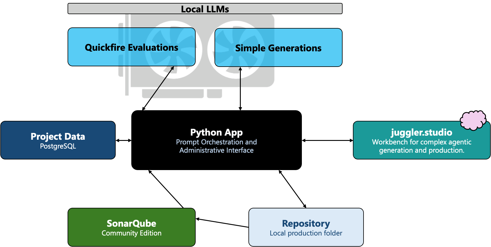

# Python Planner — original draft (v0, archived)

> Archived verbatim conversion of the CFO's draft `Python Planner.docx` (2026-11-03).
> Superseded by `docs/PROJECT_PLAN.md`. Kept unchanged for provenance — do not edit.

# Definitions:

\[Add more key terms and definitions here\]

*Prompt Packet:* Federated task metadata recursively evaluated to fill
and substantiate fields. New packets are created for new independent or
parsed tasks. Parsed packets do not remove the original but create
branches where the new packets have a linked history.

*Candidate Field*: Data validated tags and scores filled with local LLM
and SQL evaluations. Results in these fields may form or contribute to
the updating of master governance fields via SQL.

*Tag*: Each available tag should be treated as a toggle.

*Task Branching*: Multiple tags or threshold scores in key Candidate
fields triggers task branching.

# Stack Overview

## The key idea: 

Build an automous project software dev stack with a custom Python
kernel. It should be utilised for organising and advancing project work
automously for the user while they are working their day job.

## Requirements:

A. Consolidate messy project planning documents into a standardised
database.

B. Utilise LLMs to conjunction with SQL scripting to fill out the
metadata.

C. Autonomously evaluate and transform the database based on *Scores and
Tags*.

D. Operate continuously create and execute *Complex Tasks* autonomously
on a readable workbench

E. Allow the user to configure manual input and agent idependence scopes
at each key stage.

F. Preserve completed work as immutable to the AI.

## Flowchart:

{width="7.5in" height="3.777083333333333in"}

### 

### Process Order Outline

*Part 1. Initial project set up / Loop interruptions*

i)  A project planning document / manual prompt is fed into the Python
    application GUI.

ii) Python sends this to Juggler to extract a standardised tree of
    *Project*, *Objective* and *Task* core fields.

*Part 2. The automation loop*

a)  The tree is evaluated by tiny LocalLLMs to fill schema-dependent
    scores/tag candidate fields.

b)  Evaluations are further processed / aggregated by SQL.

c)  Python manages implements emergently completed Prompt Packets
    through applicable channels.

d)  Python integrates relevant 'Branches' of the emergent repo with
    SonarQube.

#  Summary of Stack

## GUI 

For each Project, display a drillable tree of prioritised Tasks
per-Objective. The goal here is to complement (and take inspiration
from) Juggler, by ensuring that every element is view / edit enabled.
The overall structure being:

*'Project' \> 'Objective' \> 'Task (Prompt Packet)*

Any emergent product repo will be built in a local folder outside of the
Python GUI.

### Attribute levels

[]{#_Toc241788414 .anchor}Project level attributes include: Name, Brief,
Industry, Sectors, Values, Goals, Scope, References etc, which will be
used as a part of Task / Objective creation and SQL management.

[]{#_Toc241788415 .anchor}Objective level attributes include unique
"Project" style fields (Name, Brief etc) as well as additional tags and
scores. Values generated by an LLM must always be confirmed manually.
Values may also be filled by SQL processing data from specified sources
within the project.

[]{#_Toc241788416 .anchor}Task level attributes The expansive array of
data fields which substantiate the Prompt Packets. Tasks are directly
processed through Channels and SQL to fill out Prompt Packets.

### Design Vision

\[Insert image generations showing potential examples of GUI states\]

##  

## Prompt Packets

Prompt Packets are structured task units prepared for routing through
the stack's content-generation channels. Each packet carries the core
fields established during project set-up including project metadata and
the objectives and tasks derived from the source material together with
emergent governance and evaluation data required to generate an certain
kind of output (see thresholds). These stable fields define what the
work is and where it belongs. Candidate fields serve a separate purpose:
they are populated by targeted evaluation prompts that classify, score
and test the task so that SQL and Python can determine how the packet
should be prioritised, routed, split or processed. In this way, the
packet combines an authoritative task definition with an evaluative
layer that guides execution without replacing the underlying project
structure.

### Master Governance Fields (expanded version in [section](#_SQL_Powered_Statistic) on SQL)

Unique ID - For tracking

Prompt Description - Plain text description of task

Response Structure - What schema constraints / data validation rules
apply to the output

Channel - Identifies the routing stage (e.g. Local Evaluation, Local
Generation, Workbench Production)

Priority level - Unique and complex score controlling which prompts are
processed next at each stage

Status Tag - e.g. Archived, In Queue, Processed

Packet Creation timestamp - When the packet was created

Evaluations \# - How many evaluation prompts have been conducted

Repo Target Path - The section of the repo where generated content
should live

Completion Timestamp - When the content was generated (i.e. packet is
archived).

Other SQL powered statistics -- Jump to '[SQL Powered Statistic
Fields'](#_SQL_Powered_Statistic)

### *Candidate Fields: For Quickfire Evaluations*

Artifact request classes - Source Code, Configuration, Documentation,
Test, Dataset, Schema, Prompt, etc

Representation formats - Plain Text, Markdown, JSON, YAML, XML, CSV,
SQL, Binary, etc

Repository roles -- Executable, Declarative, Reference, Validation,
Build, Deployment etc

Fields - Education, Data Analysis, Software Development, IT Generic,
Law, Start up, Music, Care, etc

Styles - Creative, Brainstorm, Technical, Draft, Prototype, Analysis,
Corrective, Plan, Production, etc

Tools needed - Natural Language, CSV creation, CSV extraction, Python,
JSON parse, etc

Task parsability - This task should be split up into independent
subtasks

Context volume - This task requests evaluation of a large amount of
context.

Context independence - Text prompt output quality without context.

Web independence - Task output quality without online research.

Coding intensity - This task involves writing lots of code.

Reasoning intensity - This task involves complex multistep problem
solving.

Output wordcount - This task requires a lengthy response.

Ambiguity quotient - The prompt is highly ambiguous.

\[Add further evaluative fields here if necessary\]

##  

## SIX-PASS Quickfire Evaluation Design

Stateless local dual-LLMs power a rapid recursive background process of
evaluation with multiple prompt rounds. In the example design below,
models independently assess their own evaluation and each other's. Both
models stay loaded and

Target Candidate Field: tools_needed

Model A responds with tools_needed_a

Model B responds with tools_needed_b

Model A evaluates tools needed b: {evidence_b2, accuracy_score_b2,
reason_b2}

Model B evaluates tools_needed_a: {evidence_a2, accuracy_score_a2,
reason_a2}

Model A evaluates tools needed a: {evidence_a1, accuracy_score_a1,
reason_a1}

Model B evaluates tools_needed_b: {evidence_b1, accuracy_score_b1,
reason_a1}

Both model outputs are stored, and SQL aggregates values.

Note: A similar model may be used when building an agentic tool for
*Initial project set up / Loop interruptions*, with:

└── Pass 7: Model C aggregates remaining text responses into one final
value per field.

### Mock-up prompts representing each evaluative layer:

#### *Candidate value extraction: Passes 1 & 2*

\"Read *project_document* and respond only with the most appropriate
value for \'*candidate_field*\'. If insufficient information exists,
return NULL. Respond only with a single \'*candidate_value*\'.\"

#### *Accuracy Scores: Passes 3 & 5*

Read project_document and determine the accuracy of "candidate_value" as
a "candidate_field". Consider the applicabilty, relevance, prevalence of
evidence, contradictions and ambiguity. The question is: 'Has the
candidate value been accurately generated?' Respond only with a single
estimated 'accuracy_level' score.

#### *Evidence finding: Passes 4 & 6*

Read project_document and identify the strongest evidence supporting or
contradicting "candidate_value" as a value for "candidate_field". Return
only exact quotations from the document. Add a tag of either SUPPORT or
CONTRADICTION. If no relevant evidence exists, return NULL.

### Additional Candidate Fields for Quickfire Content Evaluation

While content generated by local models or on the workbench into the
repo receives an immediate objective assessment from SonarQube,
additionally, a unique content evaluation task (Prompt Packet) is
created. Such evaluations are processed by the same stateless quickfire
channel and models as used in 'Task Evalution' however they have
additional distinct schema (candidate fields).

Testability - The content can be verified through deterministic tests or
defined acceptance criteria.

Requirement alignment (m) - The content satisfies the associated task,
objective and project requirements.

Correctness - The content is technically and logically accurate.

Internal consistency - The content contains no conflicting claims,
structures or behaviours.

Functional completeness - The content contains all components needed to
perform its intended function.

Repo consistency - The content is compatible with the surrounding
repository, conventions and dependencies.

Maintainability - The content is clear, modular and practical to modify.

Security risk - The content introduces unsafe behaviour, exposed secrets
or avoidable vulnerabilities.

Duplication quotient - The content unnecessarily reproduces existing
repository material or logic.

Technical Debt - The content includes techniques and processes that will
make future work difficult.

Additional fields: 

• Acceptance-criteria coverage - The proportion of explicit acceptance
criteria addressed by verifiable output evidence. 

• Dependency validity - Referenced libraries, files, interfaces and
upstream artifacts exist and are compatible. 

• Determinism - Repeated execution under the same declared inputs
produces acceptably stable results. 

• Observability - The content provides sufficient logging, errors,
metrics or trace points for diagnosis. 

• Reversibility - Changes can be rolled back without losing prior valid
state or provenance. 

• Documentation adequacy - Required usage, configuration and maintenance
information accompanies the artifact. 

• Performance risk - The content introduces avoidable latency, memory,
storage or compute costs. 

• Portability - The artifact avoids unjustified environment-specific
assumptions. 

• Data integrity risk - The content may corrupt, silently discard or
inconsistently transform governed data. 

• Privacy risk - The content exposes or mishandles personal,
confidential or restricted information. 

• Licence and provenance risk - Dependencies or incorporated material
lack acceptable origin, licence or attribution evidence. 

[]{#_SQL_Powered_Statistic .anchor}

## CUSTOM SQL CALCULATIONS

SQL provides the deterministic control and analytical layer beneath the
Python orchestrator. It does not generate project content or replace
Python's responsibility for execution. Its role is to persist a
carefully calculated state of metric integrity by maintaining relational
spaces that Python can act upon.

master governance fields,

an aggregate final value from six-pass quickfire evaluations, various
average types and statistics across the dataset.

General Statistics (always applies to both independent or branched
packets):

Prompt packet wordcount with and without expanded/enumerated context,

evaluation run counts and cumalative time used,

elapsed lifecycle duration,

scores above threshold

evidence item count

generation time used

### PACKET THRESHOLDS

dynamic thresholds for branch triggers

Federative Statistics (only applies for branched packets) --

Background

IDs of objective or repo entries in associated trunk.

Original packet creation timestamp,

cumulative generation time used,

score variance,

revision count,

failed or rejected run count,

output wordcount history,

model usage distribution,

contradiction count,

requirement coverage percentage,

repo write count last successful repo commit timestamp.

PYTHON TOOL CALLING

SQL stats can be further split into Evalution & Generation & Combined.

## 

[]{#_Toc241788425 .anchor}

## PYDANTIC VALIDATION

Each channel uses Pydantic to validate output structure, so at any given
moment Pydantic will be verifying up to 3 Run ID contracts. For example,
if there were a console, it might look like:

Quickfire Evaluation is verifying #CE16709 \[attempt 1/4\]

Local Generation is verifying #TC212 \[attempt 2/3\]

Workbench Production is verifying #Li69 \[attempt 1/2\]

All possible response contracts need to be recognises

##  Loop interruption / Initial Project set-up Handling

This section covers the stacks capacity to automatically fill / evaluate
a project's core fields using a complex prompt. Input of a custom prompt
pauses packet queue delivery allowing additions and reevaluation to core
fields.

# Tool Design

2\. Read and control the Juggler Interface, including:

\* conversation selection

\* model selection

\* prompt insertion

\* model outputs

\* error messages

2\. The ability to pass prompts and files to various models directly

The ability to speak to
